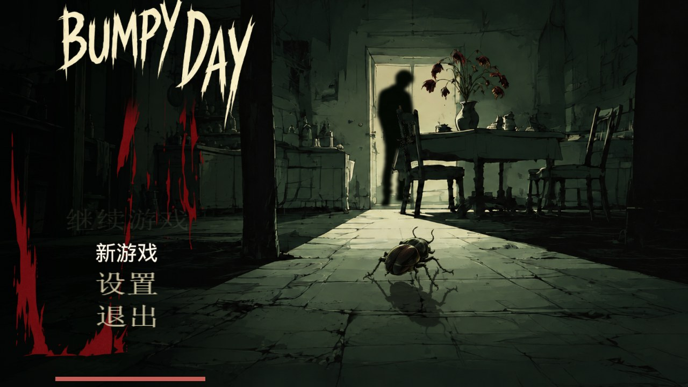
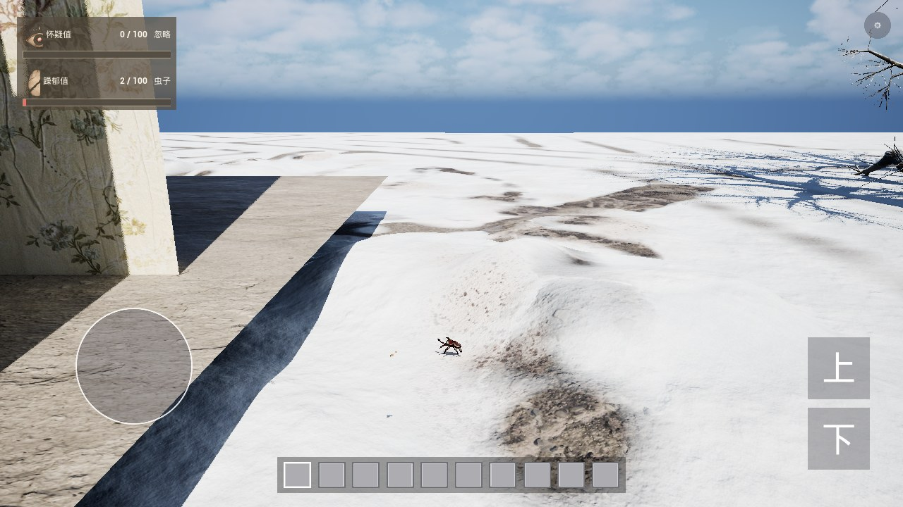
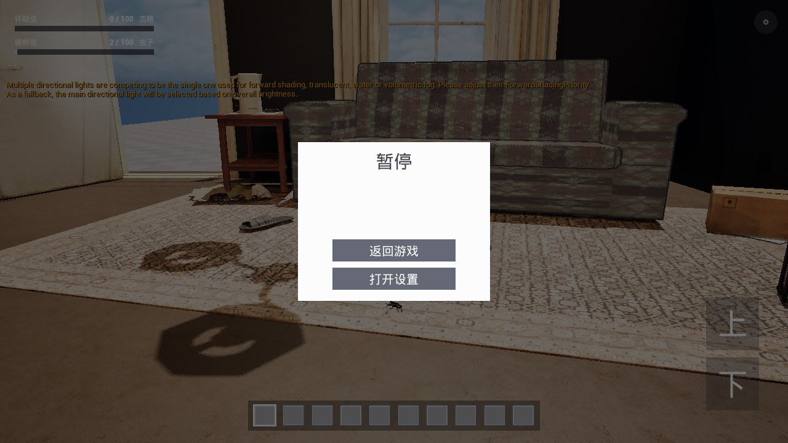
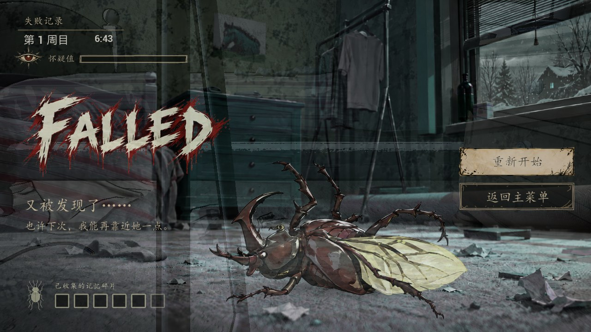
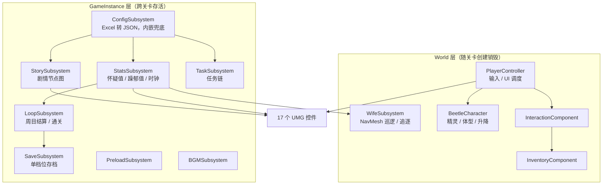

# Metamorphosis

**一只断腿的甲虫，一间冬天的公寓，一个不断重来的日子。**

2D 精灵主角 × 3D 写实场景的叙事潜行游戏 · Unreal Engine 5.6 · C++ 玩法与 UI 全部手写 · 面向移动端


-3DA639)



## 项目速览

| 项 | 内容 |
| --- | --- |
| 引擎 | Unreal Engine 5.6 |
| 语言 | C++20（玩法 / UI / 输入）、Python 3（编辑器工具链） |
| 规模 | 116 个 C++ 文件、约 3.2 万行；36 个 Python 工具、约 3000 行 |
| 内容体量 | 58 个剧情节点、11 种道具、12 条任务、3 个时段 |
| 架构 | 10 个 Subsystem 分层 + 事件驱动 UI，无 Widget 蓝图 |
| 平台 | Android（API 29+，OpenGL ES3.1 回退）/ Windows |
| 开发周期 | 2026-10-09 → 2026-10-21（13 天，152 次提交） |
| 许可 | 代码 MIT，美术 / 音频资源保留所有权利（见 [LICENSE](LICENSE)、[LICENSE-CONTENT.md](LICENSE-CONTENT.md)） |

## 这是什么

玩家扮演一只在暴雪来临前闯入公寓的甲虫 **Bumy**。它断了条腿、飞不快、随时会被发现，
必须在一家人的日常动线之间觅食、躲藏、长大，然后找到离开这间屋子的缝。

游戏以「天」为单位循环：每天 06:00 醒来，23:00 入夜。被妻子发现会被一拖鞋拍死，
然后带着上一轮的记忆重新开始 —— 怀疑值不会清零，只是退一格。

项目目前完成的是**可玩竖切**：从开场、卧室探索到客厅第二幕，串起一条完整的剧情线；
数值、AI、剧情、存档、UI 全部闭环，从主菜单 Start 到失败结算、重新开始、继续游戏都能跑通。

|  |  |
| --- | --- |
|  |  |
| 写实比例的公寓场景，主角是手掌大小的 2D 精灵 | 纯 C++ 构建的 UMG 界面（暂停 / 设置 / 背包） |
|  | |
| 被捉后的周目结算：五阶段流程，等待玩家选择 | |

## 一局是怎么玩的

```
06:00 ────────────── 探索 / 觅食 / 躲藏 ────────────── 23:00 入夜
  │                                                        │
  ├─ 怀疑值 0–100：40 进入「搜寻」，90 进入「暴露」，100 被捉
  ├─ 躁郁值 0–100：决定体型三阶段（1× → 2× → 4×），越躁越显眼、也越容易被看见
  └─ 被捉 / 入夜 → 周目结算 → 怀疑值 -20、保留记忆、回到起点再来一天
```

- **怀疑值**：被看见、制造声响会涨；躲起来会按 `DecayPerSecond` 衰减，但有一次增长后 2 秒的延迟保护，避免抖动。
- **躁郁值**：饥饿与惊吓会涨，进食会降。涨到阈值就「长大一阶」，碰撞体、贴图、飞行手感一起变，代价是更容易被发现。
- **妻子**：平时按 NavMesh 在可达区域巡逻，到点停留、左右张望；主控进入第三阶段时转为追逐。
- **失败不是重开游戏**：进入结算流程 → 显示反馈 → 等玩家点「重新开始 / 返回主菜单」，而不是黑屏闪一下把玩家弹回起点。

## 系统一览

| 系统 | 位置 | 说明 |
| --- | --- | --- |
| 数值 / 时间 | [`Stats/`](Source/Metamorphosis/Stats) | 怀疑值、躁郁值与游戏时钟；事件委托广播给 UI，UI 不轮询 |
| 妻子 AI | [`AI/`](Source/Metamorphosis/AI) | NavMesh 巡逻 + 停留张望 + 视锥/遮挡判定 + 第三阶段追逐 |
| 剧情 | [`Story/`](Source/Metamorphosis/Story) | 58 节点的有向图；节点带 Effect、Condition、分支与玩法门 |
| 周目结算 | [`Loop/`](Source/Metamorphosis/Loop) | 五阶段状态机（冻结 → 反馈 → 等待选择 → 重置 → 恢复）与通关流程 |
| 存档 | [`Save/`](Source/Metamorphosis/Save) | 单档位、带版本号、60 秒自动存、读档保护窗口 |
| 交互 | [`Interaction/`](Source/Metamorphosis/Interaction) | 0.15 秒扫描最近可交互物；正式 Actor 与标签两种接入方式 |
| 背包 | [`Inventory/`](Source/Metamorphosis/Inventory) | 8 格；配表驱动堆叠 / 使用 / 丢弃，丢弃时还原原网格与朝向 |
| 配置 | [`Config/`](Source/Metamorphosis/Config) | USTRUCT 与 Excel 表头一一对应；文件 → 内嵌 JSON 两级兜底 |
| UI | [`UI/`](Source/Metamorphosis/UI) | 17 个 UMG 控件类，纯 C++ 构建与布局 |
| 输入 | [`Input/`](Source/Metamorphosis/Input) | Enhanced Input，运行时构造 Action；键鼠 / 手柄 / 触屏三套并存 |
| 预加载 | [`Game/`](Source/Metamorphosis/Game) | 编辑器烘焙资源清单写进 ini，运行时异步加载，减少进关卡顿 |
| 音频 | [`Audio/`](Source/Metamorphosis/Audio) | BGM 播放、音量与暂停的联动 |

## 架构



三点设计取舍：

1. **状态挂在 Subsystem 上，不挂在 Actor 上。** 换关卡、重新读档、从主菜单再开一局时，
   数值、剧情进度、周目次数都必须活下来；Actor 会被销毁，Subsystem 不会。
2. **UI 只订阅事件，不反向查询。** 所有数值变化通过多播委托广播，UI 收到后自行刷新；
   避免每帧 `GetSuspicion()` 轮询，也让 UI 与玩法彻底解耦。
3. **配置只有一处真相。** Excel 是唯一数据源，导出脚本生成 JSON，JSON 再被编译进二进制兜底
   （Android 包内非资产文件读不到，踩过这个坑）。

## 几个实现细节

### 1. 数据驱动的配置管线：Excel → JSON → 内嵌 .inl

策划只改 `ConfigSource/数值配置表.xlsx`，跑一次 `python Tools/export_config.py`，
脚本会校验时刻格式、数值越界、引用完整性，再生成 `Content/Config/game_config.json`，
同时把同一份 JSON 写成 `Source/Metamorphosis/Config/GameConfigJson.inl` 编译进模块。

运行时的载入顺序是「文件 → 内嵌」，因此：

- 编辑器里改表**不用重编**，重启即生效；
- Android 打包后即便非资产文件没被带进包，也还有一份内嵌数据兜底，不会出现任务栏 / 交互全空。

→ [`MetamorphosisConfigSubsystem.h`](Source/Metamorphosis/Config/MetamorphosisConfigSubsystem.h)、[`Tools/export_config.py`](Tools/export_config.py)

### 2. 妻子的 AI：NavMesh 取点，而不是手写航点

第一版是「手写航点 + 向下打线」，结果 100cm 直径的替身直接穿床、穿桌、穿墙。
现在改成在 NavMesh 上 `GetRandomReachablePointInRadius` 取点、`FindPathToLocationSynchronously` 求路径，
引擎按 agent 半径生成导航网格，天然留出体积间隙。

几个踩过的坑都写在代码注释里：运行时 Spawn 的 `NavMeshBoundsVolume` 没有 brush、包围盒体积为 0 会被导航系统忽略，
所以补了一个不参与碰撞的 `BoxComponent` 提供有效包围盒；她自己必须 `SetCanEverAffectNavigation(false)`，
否则会在 NavMesh 上挖洞并随移动不断重建；替身的 XY 缩放还要对齐到 agent 半径，否则缝隙过不去。

→ [`MetamorphosisWifeSubsystem.h`](Source/Metamorphosis/AI/MetamorphosisWifeSubsystem.h)

### 3. 周目结算：为什么用 FTSTicker 而不是 TimerManager

结算流程有五个阶段（冻结输入 → 全屏反馈 → 等待选择 → 应用重置 → 恢复），中间玩家可能点开弹窗把游戏暂停。
`FTimerManager` 走的是游戏时间，一暂停计时器就停住，结算永远走不完；这里改用 `FTSTicker` 的真实时间，
并对「已在结算中 / 冷却中 / 已通关」的重复请求做了幂等保护。

→ [`MetamorphosisLoopSubsystem.h`](Source/Metamorphosis/Loop/MetamorphosisLoopSubsystem.h)

### 4. 存档：版本号 + 读档保护窗口

单存档位，`CurrentVersion` 随字段变更自增，旧档会被拒绝并提示。
读档时有 3 秒保护窗口：这期间忽略所有周目结算请求，否则残留的「门超时 / 被抓 / 剧情 Death」
会在读档瞬间触发一次完整重置，玩家看到的就是「读档后位置不对、背包消失」。
另外 `LoadNow` 分「只挂起」和「立刻应用」两种模式，专门解决跨关卡换角色时背包写错对象的问题。

→ [`MetamorphosisSaveSubsystem.h`](Source/Metamorphosis/Save/MetamorphosisSaveSubsystem.h)

### 5. 移动端输入：三套设备共用一套 Action

Enhanced Input 的 `UInputAction` / `UInputMappingContext` 全部在 C++ 里运行时构造，
不依赖任何输入资产。移动端在左半屏生成虚拟摇杆，右半屏手指左右搓直接映射成相机 yaw；
桌面端是 WASD + 鼠标，手柄是双摇杆。空格上升、X 下降、双击空格落地 —— 没有单独的「飞行模式」开关。

→ [`MetamorphosisMoveInput.h`](Source/Metamorphosis/Input/MetamorphosisMoveInput.h)、[`MetamorphosisPlayerController.h`](Source/Metamorphosis/MetamorphosisPlayerController.h)

### 6. 预加载：把 AssetRegistry 的查询结果烘焙成清单

运行时（尤其是打包后）AssetRegistry 是空的，查不出关卡依赖了哪些包。
所以在编辑器里跑 `Tools/bake_preload_list.py`，把依赖清单写进 `DefaultGame.ini` 的一段标记区块，
运行时按清单异步加载。脚本只改标记区块内的内容，手写配置不会被动。

→ [`MetamorphosisPreloadSubsystem.h`](Source/Metamorphosis/Game/MetamorphosisPreloadSubsystem.h)

### 7. Python 工具链：36 个编辑器脚本

美术交付的是 619 张 PNG，引擎里实际只用 ~95 张。工具链负责按目录名 + 文件名精确挑图、
统一改成 ASCII 名、按验证过的参数导入（mip / sRGB / 压缩格式 / TextureGroup）、
以及把配表导出成 JSON。U 盘式的重复劳动全部脚本化。

→ [`Tools/`](Tools)

## 目录结构

```
Metamorphosis/
├── Source/Metamorphosis/
│   ├── AI/            妻子 AI：巡逻、视线、追逐
│   ├── Audio/         BGM 子系统
│   ├── Character/     甲虫主角、妻子精灵、移动组件
│   ├── Config/        配表结构 + 载入（含内嵌 JSON 兜底）
│   ├── Game/          预加载、设置
│   ├── Input/         Enhanced Input 运行时构建
│   ├── Interaction/   交互扫描与拾取
│   ├── Inventory/     8 格背包 / 快捷栏
│   ├── Loop/          周目结算与通关
│   ├── Save/          存档
│   ├── Stats/         怀疑值 / 躁郁值 / 游戏时钟
│   ├── Story/         剧情节点图
│   ├── Tasks/         任务链
│   ├── UI/            17 个 UMG 控件
│   └── Variant_*/     引擎模板自带的示例变体（未参与主玩法）
├── Config/            引擎 / 游戏配置（数值、按键、打包设置）
├── ConfigSource/      策划表格源文件（数值配置表.xlsx）
├── Content/           自制资源：关卡、UI、甲虫、音频、材质
├── Tools/             编辑器脚本：导入、烘焙、检查、配表导出
├── Build/Android/     Android 打包配置与图标
└── Screenshots/       README 截图
```

## 快速开始

### 环境

- Unreal Engine **5.6**（Epic Games Launcher 安装）
- Visual Studio 2022，勾选「使用 C++ 的游戏开发」工作负载与 Windows 10/11 SDK
- 可选：Android Studio + SDK/NDK（打包安卓时用 UE 自带的 `SetupAndroid.bat` 配置）

### 编译运行（Windows）

```bash
# 1. 生成工程文件
右键 Metamorphosis.uproject → Generate Visual Studio project files

# 2. 编译
打开 Metamorphosis.sln，配置选 Development Editor / Win64，生成

# 3. 启动
双击 Metamorphosis.uproject
```

默认启动地图是 `/Game/Maps/MainMenu`，游戏关卡是 `/Game/mymap/map/Untitled`。

### 打包 Android

项目默认 **API 29+**、`bBuildForES31=True`，并保留 Vulkan 开关（部分机型 Vulkan 黑屏时可关掉强制走 ES3.1）。
配置好 UE 的 Android 工具链后，用 `Platforms → Android → Package Project` 即可。

### 配表工作流

```bash
# 改完 ConfigSource/数值配置表.xlsx 之后
python Tools/export_config.py
# 生成 Content/Config/game_config.json 与 Source/Metamorphosis/Config/GameConfigJson.inl
# 编辑器内重启游戏即可生效；打包前需要重新编译一次，让内嵌版本同步
```

### 调试命令

游戏内控制台（`` ` `` 键）可用一组 `Meta.*` 命令，例如：

| 命令 | 作用 |
| --- | --- |
| `Meta.Suspicion.Add 20` / `Meta.Mood.Add -10` | 直接改数值，验证阈值与 UI |
| `Meta.Wife.Info` / `Meta.Wife.Goto X Y` | 查看妻子状态、把她叫到指定坐标 |
| `Meta.Story.Play <NodeId>` / `Meta.Story.Advance` | 从任意节点播剧情 / 推进一句 |
| `Meta.Interact.Scan` / `Meta.Interact.Do` | 列出附近可交互物 / 立即交互一次 |
| `Meta.Save.Load` / `Meta.Loop.NightEnd` | 读档 / 手动触发入夜结算 |

## 资源与许可

**代码**（`Source/`、`Tools/`、`Config/`、`Build/`）采用 [MIT](LICENSE) 许可证。

**美术 / 音频**（`Content/`、`ConfigSource/`）为项目原创，保留所有权利，仅用于展示，
详见 [LICENSE-CONTENT.md](LICENSE-CONTENT.md)。

**不包含的第三方资源。** 场景搭建用到了几个商城资源包，按各自 EULA 不能随仓库分发，因此已从本仓库移除：

| 目录 | 用途 |
| --- | --- |
| `Content/AtmosphericHouse/` | 公寓主体建筑与家具 |
| `Content/SovietFlat/` | 室内陈设 |
| `Content/Nuclear_winter/` | 冬季外景与天气 |
| `Content/Characters/Mannequins/` | 引擎自带人形（模板残留） |

这会导致直接打开主关卡时部分网格缺失（显示为默认立方体或空引用），但不影响代码阅读与编译。
若要完整还原画面：从 Fab / Epic 商城获取对应资源包，按上表目录名放回 `Content/` 即可。

## 已知限制

- 目前只做到第一章竖切（卧室 + 客厅）；客厅的餐桌戏与后续章节仍是设计稿。
- 妻子是临时圆柱体替身，2D 精灵已经接好但美术资源尚未替换。
- 「是否穿风衣」的状态还没做，AI 里按「阶段 2+ 视为无风衣」的占位规则处理。
- 入夜结算的手动入口已接好，自动触发还差一处接线（见 `StatsSubsystem` 与 `LoopSubsystem` 的注释）。
- 代码注释为中文，记录了大量「为什么这么改」的决策过程；部分注释引用了开发期的内部笔记（未随仓库发布）。
- 没有 CI：UE 工程编译需要完整引擎，未做自动化构建。

## 关于

一个从 0 开始、13 天做出来的可玩竖切。所有玩法系统、UI、工具链都是手写的 C++ 与 Python，
没有用蓝图拼逻辑 —— 这样每一处行为都能在代码里被读到、被 review、被改。

如果这个项目对你有帮助，欢迎 star；有实习机会也欢迎联系。

- GitHub：[@Lan1er](https://github.com/Lan1er)

---

<sub>Unreal Engine 是 Epic Games, Inc. 的商标。本项目与 Epic Games 无隶属关系。</sub>